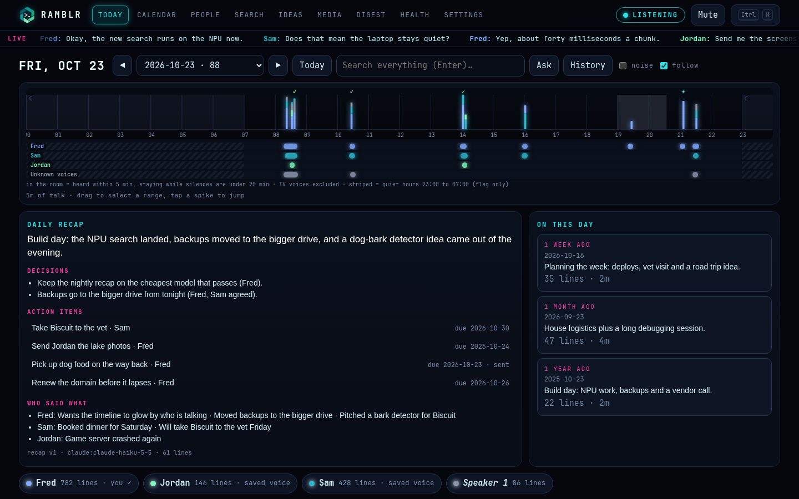
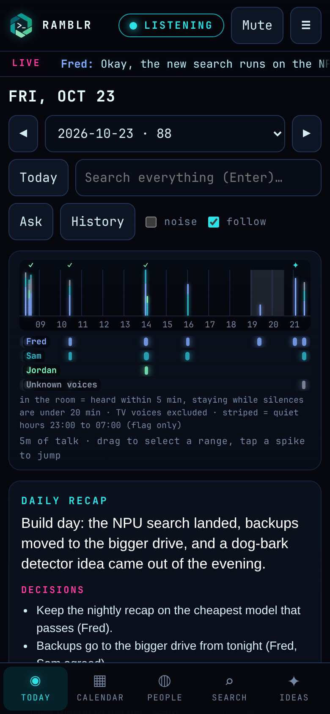
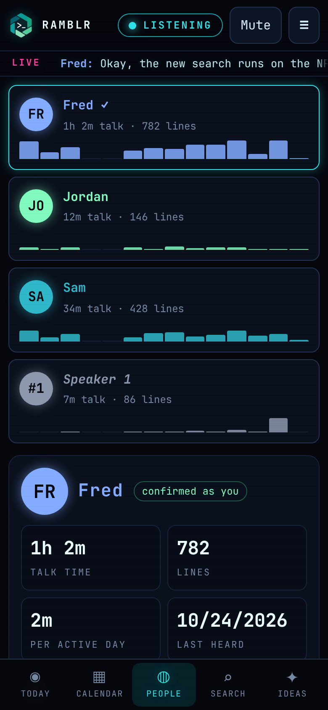
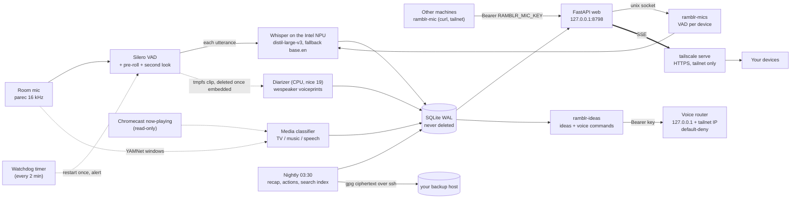
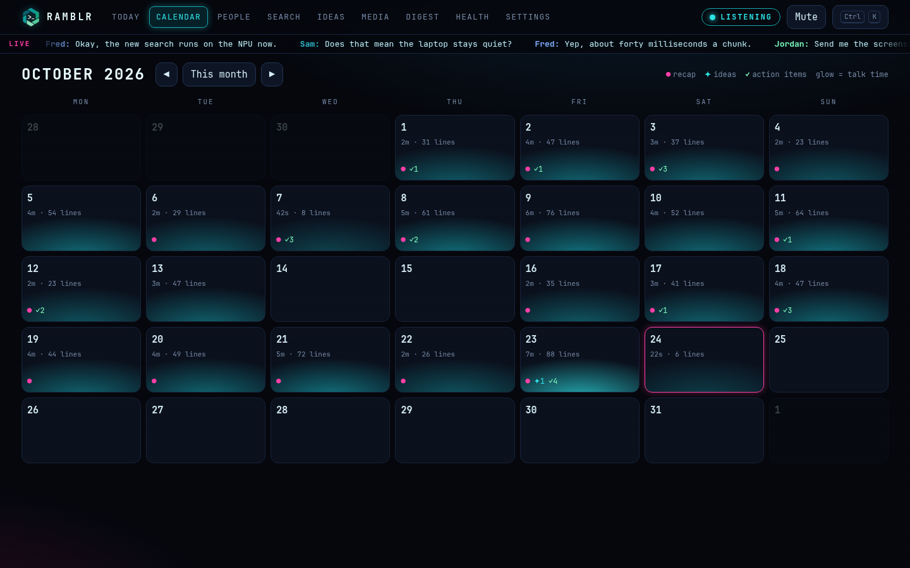
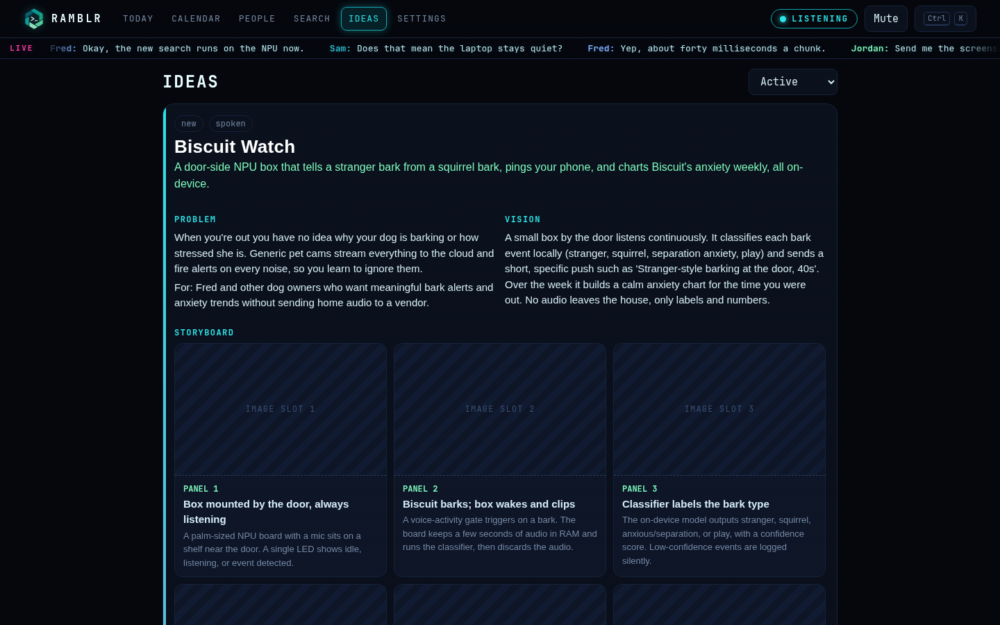

<p align="center">
  <picture>
    <source media="(prefers-color-scheme: dark)" srcset="assets/brand/nixfred-logo.svg">
    
  </picture>
</p>
<p align="center"></p>

<p align="center">
  
  
  
  
  
  
</p>

**Always-on, private ears for your room. Ramblr hears speech, transcribes it on the Intel NPU the moment you stop
talking, works out who said it, tells the TV apart from the people, and turns spoken ideas into projects. Audio never
leaves the machine, and the site is only reachable over your tailnet.**



<p align="center">
  
  
</p>

<sub>Every screenshot is rendered from a generated demo database (made-up people "Sam", "Jordan" and a dog called
"Biscuit"); none of it is real room audio.</sub>

## What it is

Ramblr is a handful of small `systemd --user` services on one Linux box with an Intel Core Ultra NPU:

1. **Listen.** A PipeWire client reads the mic at 16 kHz. Silero VAD keeps only speech; a second look before each
   onset recovers words the VAD misses under music.
2. **Transcribe.** Every utterance goes to Whisper on the NPU (OpenVINO GenAI) as soon as it ends, typically in
   under a second. The model is picked by measurement (`bench/`); today that is distil-whisper-large-v3 (int8), with
   whisper-base.en as an automatic fallback.
3. **Store forever.** Text lands in SQLite (WAL) under `~/.local/share/ramblr`. Triggers block every `DELETE`.
   Transcripts are never pruned. Raw audio is kept compressed for a rolling 24 hours only, so you can press play on a line.
4. **Understand.** A diarizer labels speakers from voiceprints. A YAMNet classifier and the Chromecast now-playing
   feed tell TV and music apart from the room, AcoustID names songs, and a text guard hides Whisper loops.
5. **Show.** A FastAPI site on `127.0.0.1:8798`, published to your devices by `tailscale serve`, streams new lines live
   (server-sent events) and adds recaps, search, people, media, ideas, a calendar and a health page.
6. **Act, only when you say so.** "Larry, have Grok bot ..." becomes a voice command for a tailnet-only router that
   is default-deny: anything that could change something waits for your Approve.

## Architecture



| Unit | Job |
|---|---|
| `ramblr-capture.service` | mic, VAD, NPU Whisper, media classifier, 24 h audio, store, notify |
| `ramblr-diarize.service` | speaker voiceprints in batches (`Nice=19`, 1 thread, `CPUQuota=50%`) |
| `ramblr-web.service` | the site, SSE, uploads, mic relay; `127.0.0.1:8798` only |
| `ramblr-mics.service` | extra mics streamed over the tailnet (one VAD per device, shared NPU Whisper) |
| `ramblr-ideas.service` | spoken-idea detection, storyboards, voice-command detection and routing |
| `ramblr-router.service` | the voice router: 127.0.0.1 and the tailnet IP only, bearer key, default-deny |
| `ramblr-watchdog.timer` | every 2 min: speech heard but no lines, or a stuck loop: fall back to base.en, restart once, alert |
| `ramblr-retention.timer` | hourly: deletes only `.opus` chunks older than 24 h in the audio store |
| `ramblr-nightly.timer` | 03:30: recap, action items, idea backstop, NPU search index, encrypted backup |

Unit files live in [`systemd/`](systemd/); `./install.sh --enable` copies them to `~/.config/systemd/user/`.

## Features

| | |
|---|---|
| **Live transcript** | Each line on the page about 0.9 s after you stop talking. Copy any range as clean `[14:03:12] Name: text`. |
| **Speakers** | Voiceprints (wespeaker ResNet34 on the CPU). Name a voice once and it is labelled from then on. A named person needs a 0.90 match and a 0.10 lead over every other named person; nobody is named while the TV is on, so one voiceprint cannot swallow the room. Reassign, propagate, undo. |
| **TV, music and the room** | YAMNet on the NPU per mic, a speech-occupancy feature (broadcasts never pause), sticky media stretches, and the Chromecast now-playing title. "Music" only for a named song or strong music with little speech, otherwise "TV". Mark one line TV and the whole stretch follows (one undoable batch). Media lines are hidden, never deleted. |
| **Song names** | Chromaprint plus AcoustID (optional key). |
| **Extra mics** | `clients/ramblr-mic` streams another machine's mic (curl plus parec or arecord, no Python) over the tailnet. `startmic` / `stopmic` turn it on and off on that machine (`clients/startmic`, `clients/stopmic`). |
| **Voice commands** | "Larry, tell/ask/have/get <bot> (to) <task>", also split over several lines, with a clipped wake word if a bot is named, and host names by sound ("on gas" means gus). Only your voice counts; an unknown voice is held. The router holds anything that could send, spend, delete, install or change something until you Approve it. |
| **Imports** | iPhone rambles through a signed Shortcut (`/api/upload`, its own key), Zoom transcripts and Wispr Flow notes. Imported text never triggers a command. |
| **Ideas to projects** | Spoken ideas become briefs, storyboards with NPU-drawn panels, and optional hand-off to a webhook you choose. |
| **Recaps and search** | Nightly recap and action items, "on this day", weekly digest, semantic search on the NPU, ask-your-transcript Q&A. |
| **Reliability** | The ASR rebuilds itself after an error and falls back to whisper-base.en once; the watchdog restarts capture once if speech is heard but nothing lands, and alerts. |
| **Never delete** | No retention for text. Every table has a `BEFORE DELETE` trigger. Corrections are audited and undoable. |

## Hardware

- **Intel Core Ultra NPU** (developed on a Core Ultra 200 series, `/dev/accel/accel0`, OpenVINO 2026). Whisper, YAMNet,
  the search embeddings and the storyboard art all run on it. No GPU is required; Ramblr never uses one except for an
  optional local Ollama model for recaps.
- Any **PipeWire/PulseAudio microphone** (developed with a USB webcam mic).
- Linux with **systemd --user**, **ffmpeg**, **uv**; optional **Tailscale** (to reach the site), **gpg** (backups),
  **chromaprint** (song names).
- Measured cost on the dev box: capture about 1.3 % of one core with an idle room; distil-large-v3 runs at RTF about 0.3 per stream on the NPU.

## Install and setup

```bash
git clone <this repo> ~/Projects/ramblr && cd ~/Projects/ramblr
./install.sh --check     # what is there, what is missing; changes nothing
./install.sh             # project .venv, Python deps, models, ~/.config/ramblr skeleton (files 600)
./install.sh --enable    # install and start the systemd --user units, then open http://127.0.0.1:8798/setup
tailscale serve --bg --https=8798 http://127.0.0.1:8798    # optional: reach it from your devices, tailnet only
```

The installer never runs sudo and never installs system packages; it prints the exact command for anything missing.
`/setup` walks through the mic, naming your voice (so only you can say "Larry, ..."), quiet hours and the extras.
Whisper models are OpenVINO IR directories (point `RAMBLR_WHISPER` at one; `tools/bench_whisper.py` compares them on your own audio).

## Configuration

Everything lives outside git in `~/.config/ramblr/`: `config.env` (settings) and `secrets.env` (`chmod 600`, keys).
Both are loaded by every unit with `EnvironmentFile=-`. Names only here; values are yours.

| Area | Variables |
|---|---|
| Capture and ASR | `RAMBLR_SOURCE`, `RAMBLR_WHISPER`, `RAMBLR_WHISPER_DEVICE`, `RAMBLR_WHISPER_FALLBACK`, `RAMBLR_ASR_MAX_TOKENS`, `RAMBLR_VOCAB_PROMPT`, `RAMBLR_VAD_THRESHOLD`, `RAMBLR_VAD_MIN_SILENCE`, `RAMBLR_VAD_MIN_SPEECH`, `RAMBLR_VAD_MAX_SPEECH`, `RAMBLR_VAD_PREROLL`, `RAMBLR_VAD_LOOKBACK` |
| Network | `RAMBLR_TAILNET_URL` (your `https://<host>.<tailnet>.ts.net:8798`), `RAMBLR_PORT`, `RAMBLR_ROUTER_PORT`, `RAMBLR_ROUTER_TAILNET_IP` |
| Speakers | `RAMBLR_SPK_MATCH`, `RAMBLR_SPK_NAMED_MATCH`, `RAMBLR_SPK_MARGIN`, `RAMBLR_SPK_UPDATE`, `RAMBLR_SPK_UPDATE_MARGIN`, `RAMBLR_SPK_LEARN_SECONDS`, `RAMBLR_SPK_MIN_SECONDS` |
| Media | `RAMBLR_MEDIA`, `RAMBLR_MEDIA_MIN_RMS`, `RAMBLR_CAST`, `RAMBLR_CAST_ROOM`, `RAMBLR_MUSIC_LOOKUP`, `RAMBLR_ACOUSTID_KEY`, `RAMBLR_PLEX_URL`/`_TOKEN`, `RAMBLR_JELLYFIN_URL`/`_KEY` |
| Voice commands | `RAMBLR_VOICE_ROUTER_URL`, `RAMBLR_VOICE_ROUTER_KEY`, `RAMBLR_BOT_ALIASES`, `RAMBLR_HOST_ALIASES`, `RAMBLR_COMMAND_JOIN_GAP`, `RAMBLR_GROKBOT_WEBHOOK_URL`/`_KEY` (optional upstream) |
| Keys for inbound streams | `RAMBLR_MIC_KEY`, `RAMBLR_UPLOAD_KEY`, `RAMBLR_HOOK_KEY` (generated on first use, never printed) |
| Imports and extras | `RAMBLR_ZOOM_ACCOUNT_ID`, `RAMBLR_ZOOM_CLIENT_ID`, `RAMBLR_ZOOM_CLIENT_SECRET`, `RAMBLR_GCAL_ICS_URL`, `RAMBLR_WEATHER_LATLON`, `RAMBLR_DOIT_WEBHOOK_URL`/`_KEY` |
| Storage and backup | `RAMBLR_DATA`, `RAMBLR_AUDIO24`, `RAMBLR_AUDIO24_CAP_MB`, `RAMBLR_BACKUP_HOST` (empty = off), `RAMBLR_BACKUP_RECIPIENT` |
| Watchdog | `RAMBLR_WATCHDOG_MINUTES` (default 10) |
| Models for text | `RAMBLR_NIGHTLY_GEN`, `RAMBLR_ASK_GEN`, `RAMBLR_STORYBOARD_GEN`, `RAMBLR_OLLAMA_URL` |

## Privacy and security model

- **Audio stays on the box.** Speech clips live on tmpfs until the voice embedding is stored, then they are deleted.
  The rolling 24 h store is compressed, `chmod 700`, size-capped, never backed up and never synced.
- **Text stays on the box,** except what you turn on: the nightly encrypted backup (gpg ciphertext to your own ssh
  host) and recaps or answers written by a model (local Ollama first; otherwise the Claude Code CLI with no tools, which
  sends that day's text, never audio).
- **Tailnet only.** The web binds `127.0.0.1`; `tailscale serve` gives your devices HTTPS. Never `0.0.0.0`, never Funnel.
  There is no login page: Tailscale is the access control. The voice router listens on `127.0.0.1` and the tailnet IP only.
- **Every inbound stream has its own bearer key** (remote mics, iPhone uploads, plugin hooks, the router), compared in
  constant time, kept in `secrets.env`, never logged or printed. The mic client refuses any URL that is not `https://*.ts.net`
  and passes its key to curl through a file descriptor (not visible in `ps`).
- **Commands are default-deny.** Only your recognised voice can raise one; an unknown voice is held; the TV and imported
  transcripts never count; the router holds anything that is not clearly read-only until you Approve it.
- **Model calls can't act.** Text models run with no tools (`claude -p --tools ""`, strict MCP config).
- **Nothing private in git:** databases, audio, embeddings, voiceprints, backups, `*.env` and keys are gitignored.

---

# Reference

The sections below document each part in detail.

## Rules the code enforces

- **Text is never deleted.** No retention, pruning or rotation exists, and a SQLite trigger aborts any `DELETE` on `segments`.
- **Raw audio is kept for 24 hours only.** Live processing uses tmpfs clips removed once the voice embedding is stored; separately the capture stream is kept compressed for a rolling 24 h (see B3-15 below). Transcripts are kept forever.
- **Real-time path.** A segment goes to the NPU as soon as VAD closes it (no batching). The page gets it by server-sent events over an in-process pub/sub, fed by a unix datagram from capture. No DB polling.
- **Provisional speakers.** A new line shows the last known voice with a `?`; the diarizer settles it in place over the same stream.
- **Voiceprints.** Rename a speaker on the site and every line updates; the voiceprint is saved, so that voice is labelled automatically from then on. Renaming to an existing name merges the two. Fixing one line teaches that voiceprint.
- **Private network only.** The server binds `127.0.0.1`. Exposure is `tailscale serve` HTTPS. Never funnel, never `0.0.0.0`.
- Python deps live in the project `.venv` only. No tokens: the VAD and speaker models are ungated downloads.

## DO IT webhook (idea hand-off)

`~/.config/ramblr/secrets.env` (`chmod 600`):

| Variable | Default | Meaning |
|---|---|---|
| `RAMBLR_DOIT_WEBHOOK_URL` | unset | Where an idea is POSTed. Unset means status `pending webhook`. |
| `RAMBLR_DOIT_WEBHOOK_KEY` | unset | Secret sent with each request. Never logged. |
| `RAMBLR_DOIT_KEY_HEADER` | `Authorization` | Header name for the key. |
| `RAMBLR_DOIT_KEY_FORMAT` | `Bearer {key}` | Header value format. |

Payload: `{idea_id, gist, brief:{...}, raw_lines:[{ts,speaker,text}], source:"ramblr", sent_at}`, with an
`Idempotency-Key: <idea_id>` header. An idea is sent at most once.

## The site

Live view of today, past days, search across all days, click a speaker to rename it, a per-line speaker fix,
and drag or shift-click lines (or pick a start and end time) then **Copy** for clean text such as
`[14:03:12] Fred: text`.

## Measured on the dev box (Intel Core Ultra 200 NPU, 2026-10-23/24)

| What | Result |
|---|---|
| Idle room, 660 s window, no speech | capture 1.29 %, web 0.16 %, diarizer 0.00 % of one core (cgroup and `/proc` agree); NPU busy delta 0 us |
| End of speech to SSE send, 29 injected segments | median 0.906 s, p95 0.988 s (min 0.869, max 1.022) |
| NPU Whisper per segment | 160 to 230 ms for 1 to 9 s of speech |
| Web process with one SSE client | 0.19 % of one core (local, 153 s), 0.16 % (over tailnet HTTPS, 32 s) |
| Offline JFK clip (11 s) | 0.63 to 0.74 s wall, 0.2 to 0.4 s CPU, NPU busy 430 to 480 ms |

Latency is measured from the VAD segment end timestamp to the moment the web process writes the SSE event;
most of it is the 0.7 s of trailing silence VAD waits for.

## Run the offline test

```bash
.venv/bin/python -m ramblr.offline sample.wav --db /tmp/test.db
```

It pushes a WAV through the same VAD, NPU Whisper and SQLite path as the live service.

## Speakers: colors, reassign, propagation, undo

- **One color per person**, stored on the person, the same on every page and API (`color` on every line). The default is a deterministic palette pick (every color at least 7:1 on the dark background); click a speaker chip to change it (anything under 4.5:1 is refused). Unnamed "Speaker N" voices stay gray and italic until named.
- **Click any speaker label** (once anyone has a name) for a keyboard-friendly picker: type to filter, arrows to move, Enter to pick or create a "New person". **Reassign** on the range bar does a whole selection at once.
- **Voiceprints learn from corrections**: a hand-set line counts double (`RAMBLR_MANUAL_WEIGHT=2`) in that person's weighted running voiceprint and is taken out of the old one.
- **Propagation**: reassigning one line re-scores that whole day against the person's updated voiceprint and the line's diarizer cluster. A toast says "Also relabeled N lines today" (the real count) with Undo and a review list; lower-confidence matches are listed for a one-click Yes/No and are not applied. Future lines follow through the cluster map. Lines you set by hand are never overwritten.

  | Threshold (cosine to the person) | Value | Why |
  |---|---|---|
  | `RAMBLR_PROP_HIGH` auto-apply | 0.78 | measured on 30 test segments with known voices: segment-to-centroid same voice 0.851 to 0.955, cross voice at most 0.703, so about 0.07 margin each side |
  | `RAMBLR_PROP_LOW` flag for a click | 0.65 | 0.65 to 0.78 is the zone where a young voiceprint (one or two samples, pairwise same voice from 0.639) and the top of cross voice (to 0.718) overlap |
  | `RAMBLR_PROP_CLUSTER` same unnamed cluster | 0.65 | the diarizer already put those lines in one voice at 0.65 or more |
  | `RAMBLR_PROP_MARGIN` | 0.05 | a line already labelled with another named person moves only if it matches the new person by this much more |

- **Never delete, always undo**: reassign, bulk reassign, merge (renaming to an existing name), rename, color and confirm all write an audit row (who, from, to, when, batch id). **History** lists them with Undo; undoing a reassign also undoes the propagation it caused, and a line someone changed since is left alone. Line counts never change.
- **"Confirm this is me"** on a speaker marks that voiceprint as you. Only your click sets it; nothing in Ramblr does it for you.
- Tests: `.venv/bin/python -m pytest -q tests` (propagation applies, skips manual lines, flags low confidence, undo restores, bulk and merge keep line counts).

## Ideas and storyboards

Say "Larry, I have an idea..." (or "Larry, I would like to work on...") and `ramblr-ideas.service` opens an idea,
keeps adding lines until "that's it" or a 60 s pause, then builds a storyboard after a 10 minute quiet period
(`RAMBLR_IDEA_QUIET`). **Build idea now** on any idea card, and **Make idea** on any selected transcript range
on the site, build immediately. Each card is a real idea storyboard, not a summary: title and pitch, problem and
audience, vision, 4 to 8 panels with a pencil sketch each (drawn on this box, see below), MVP vs later, how it gets built on
your machines, risks and open questions, your verbatim quotes, first 3 steps, and a gut-check score with a verdict.
Beside the storyboard come 2 to 4 mockups of the key screens, designed in the idea's own look.

- **Idempotent and versioned.** One idea per set of lines (trigger id or line-set hash); a storyboard exists once, and **Rebuild** adds a new version. Nothing is overwritten or deleted (SQLite triggers block it); Dismiss and Later are status changes.
- **Mockups are inert.** Plain HTML/CSS in iframes with a bare `sandbox` (no `allow-scripts`, no `allow-same-origin`), served with `Content-Security-Policy: default-src 'none'; style-src 'unsafe-inline'; img-src data:; sandbox`, after a server-side sanitizer strips scripts, links, event handlers and external URLs. PNG thumbnails (headless Playwright, JavaScript off, offline) show on phones.
- **DO IT** posts the idea (existing fields unchanged) plus the new optional `storyboard` field to the DO IT webhook; unset means "pending webhook".
- **Generator** is a config switch, `RAMBLR_STORYBOARD_GEN=claude|ollama|auto`. Default `claude`: the Claude Code CLI already logged in on the box, run as `claude -p --model claude-sonnet-5-5` from a neutral directory with project-only settings, niced, no API key. `ollama` only runs while the GPU is idle (another bot has priority) and never sends `num_ctx`.
  Local vs Claude: **not compared: GPU busy with a higher-priority user, default stays `claude -p` Sonnet.** (2026-10-24: the GPU sat at 99-100 % from another client's gemma3 requests, so the local runs only queued and timed out at 240/240/903 s; they are not retried while the GPU is busy.)

- **Panel sketches (B4-18).** Each panel gets a black-and-white pencil sketch drawn locally by LCM Dreamshaper v7 int8
  (OpenVINO, MIT, 995 MB in `models/lcm-dreamshaper-v7-int8-ov`, 4 steps at 384x384). It runs on the Intel NPU, with
  the CPU at nice 19 as the fallback, never the NVIDIA GPU. The ideas worker fills one storyboard per pass, only
  when the 1-minute load is under the core count and at least 3 GB is free, in a child process (`python -m ramblr.panelart <storyboard id>`)
  so the model leaves memory afterwards. PNGs go to `panels/<id>-<n>.png`, served at `/api/storyboards/<id>/panels/<n>.png`.
  Measured on gus: first NPU compile plus 7 sketches 67 s, then 18.7 s for 7 (compiled blobs cached in
  `cache/panelart`, about 2 GB); CPU about 11 s per sketch. A failure is shown on the slot and not retried in a
  loop. `RAMBLR_PANEL_ART=0` turns it off; `RAMBLR_PANEL_DEVICE=CPU` skips the NPU.

## MCP server (B3-2), read-only

AI clients can read Ramblr through MCP: tools `search` (FTS5 words, date range, speaker), `lines` (a day or a
range), `speakers`, `action_items`, `conversations`, `daily_summary`, `ideas`. All are marked read-only.

- **Where:** streamable HTTP at `/mcp` inside the web app, so only `127.0.0.1:8798` and the existing tailnet serve
  entry reach it (`https://gus.<tailnet>.ts.net:8798/mcp/`); never public, no new serve entry. Or stdio:
  `claude mcp add ramblr -- /home/pi/Projects/ramblr/.venv/bin/python -m ramblr.mcp_server` (not added for you;
  your Claude config is yours).
- **Security review:** the DB is opened `mode=ro` and an SQLite authorizer refuses every write, DDL, ATTACH and
  PRAGMA change (tested); there is no raw-SQL tool; all queries are parameterised and text search is reduced to
  quoted FTS tokens; limits are clamped; DNS-rebinding protection answers 421 to a foreign Host and 403 to a
  foreign Origin; no tool returns audio, files, config or secrets; TV/music lines are excluded unless asked for;
  Ask (model calls) is not exposed, so MCP use spends nothing.

## Vocabulary from your fixes (B3-1)

Double-click a line's words on Today to fix them. The original Whisper text is kept forever (`segments.text_orig`
plus every edit in `text_edits`), the changed words are diffed into learned pairs ("rambler" → "Ramblr"), and
words you add on `/settings` join them. Every new line passes through the vocabulary right after transcription
(whole words, case-insensitive) and keeps its raw text. Entries are switched off, never deleted.
Whisper's `initial_prompt` would be the natural place for this, but the NPU's static Whisper decoder in OpenVINO
GenAI 2026.3.1 rejects `initial_prompt` and `hotwords` (a shape check), so capture tries the prompt once, logs that
the device refused it, and relies on the after-transcription pass.

## Insights: facts, goals, patterns, topics, talk stats (B3-8, B3-9, B3-10)

`/insights` gathers what builds up over time:
- **Things worth remembering (B3-8):** the nightly pass asks the cheap model once per day for durable facts
  (people, preferences, plans, places), each tied to its source lines. A fact that repeats one already kept (same
  subject and the same words, or NPU-embedding cosine ≥ 0.9) only adds a mention; a fact can supersede an older
  one. "Wrong" hides a fact (a status; nothing is deleted).
- **Goals (B3-9):** stated goals ("ship X by Friday") with owner and deadline words; Done / Drop / Reopen.
- **Patterns (B3-9):** once per ISO week the cheap model turns numbers Ramblr computed (talk by person and hour,
  ideas by hour, open action items, topic trends) into a few plain insights. It never sees raw transcript here.
- **Topic trackers (B3-10):** track a word or exact phrase; mentions per day come from the FTS5 index over room
  lines (TV excluded), with a sparkline and the latest mention.
- **Talk stats (B3-10):** per person talk minutes, lines, words per minute, longest uninterrupted run, busiest hour,
  and the room's talk by hour of day.

## Ideas over time, shipped loop and X drafts (B4-2, B4-7, B4-8, B4-9, B4-10)

- **Heat (B4-2):** each night every idea is embedded on the NPU; later room talk with the same meaning (cosine ≥
  0.72) counts as it coming up again. heat = storyboard score × (1 + ln(1 + mentions)) × 0.5^(days since last touched
  / 14): ideas you keep returning to climb, ignored ones fade. Ideas page: "Hottest" view and a heat chip.
- **Lineage (B4-8):** two ideas with cosine ≥ 0.8 are the same pitch coming back; the card lists "Pitched before".
- **Weekly review (B4-7):** Ideas page "Weekly review" shows Later and Dismissed ideas from the last 4 weeks,
  hottest first, so you can revive them. `GET /api/ideas/review`.
- **Shipped loop (B4-9):** `POST /api/ideas/{id}/shipped {"repo_url": "https://..."}` (from Larry Manager when a DO IT
  project is finished; if `RAMBLR_SHIPPED_KEY` is set it must come as a bearer token) or "Mark shipped" on the card
  flips the card to 🚀 shipped with the repo link.
- **X post drafts (B4-10):** "𝕏 Draft post" on an idea, or 𝕏 on a selection on Today, drafts up to three posts in your
  plain voice (no hype, no invented claims, handles tagged once). They go to `/drafts` only; Ramblr never posts.

## Extra mics over the tailnet (B4-19)

Another machine (vic, a Pi) can stream its mic into the same timeline. Its lines show a 🎙 badge with the device
name (source `mic:<device>`), and Settings lists the remote mics and whether they are streaming.

```bash
# on the other machine: curl + parec (or arecord on a Pi), no Python, no sudo
install -m 755 clients/ramblr-mic clients/startmic clients/stopmic ~/.local/bin/
mkdir -p -m 700 ~/.config/ramblr        # then put RAMBLR_MIC_KEY=<the server's value> in ~/.config/ramblr/secrets.env (chmod 600)
echo 'RAMBLR_URL=https://<host>.<tailnet>.ts.net:8798' > ~/.config/ramblr/mic.env
cp clients/ramblr-mic.service ~/.config/systemd/user/ && systemctl --user daemon-reload
ramblr-mic --check                      # key, recorder and the tailnet path; never opens the mic
startmic                                # stream (also after reboots); stopmic turns it off and keeps it off
```

Nothing captures on the other machine until you run `startmic` there; `stopmic` stops it and keeps it off across reboots.

- **Encrypted, tailnet only.** The client refuses any URL that is not `https://*.ts.net`. Audio is TLS from
  `tailscale serve` inside WireGuard. The web binds 127.0.0.1 only, so another machine can only reach it through the tailnet.
  `POST /api/mic/stream?device=<name>` needs `Authorization: Bearer <RAMBLR_MIC_KEY>`, its own key (created in
  secrets.env on first use, never printed, separate from the iPhone upload key). The client passes it to curl
  through a file descriptor, so it never appears in `ps`.
- **Same pipeline, own service.** The web checks the key and relays the raw s16le 16 kHz stream over a 0600 unix
  socket to `ramblr-mics.service`. That service has one Silero VAD + Ingest per device and one Whisper on the NPU
  behind a lock, loaded on the first stream. Mute drops remote audio too, family mode applies, audio is never kept,
  and remote mics skip the media classifier. Connection status lives in memory only.
- **Measured on gus.** Scratch instance (never the live DB), real NPU Whisper, JFK clip streamed at real time:
  11.0 s in, 3 lines, each transcribed while the stream was still running (169-334 ms). Over the real tailnet the
  client streamed 15 s of silence through tailscale serve and got back `{"seconds":15.0,"lines":0}` with no live DB
  writes. Whisper loaded on the NPU in 1.3 s on the first stream.

### First-word clipping fix (pre-roll), 2026-10-24

Silero marks speech a little after it starts (12 to 112 ms measured on the JFK clip), enough to shave a short first
word: mic:vic stored "Good morning" as "morning". `Ingest` now keeps a ring of the last ~32 s of audio and prepends
up to `RAMBLR_VAD_PREROLL` (default 0.4 s) before every VAD onset, never reaching back into the previous line. It
covers the room mic, remote mics and uploads alike. The VAD threshold is unchanged; the test showed no need.
Measured with real NPU Whisper in 0.2 s chunks: "Ask not!" came out as "not" before and "Ask not!" after
(`tests/test_preroll.py`, which fails on the old code). Both capture and ramblr-mics load the same Whisper
(the model set by `RAMBLR_WHISPER`), and the vocabulary applies to every source; "Ramblor" -> "Ramblr" was added.

### Second look before each onset (2026-10-24 11:50)

Over music the running VAD can miss a whole short utterance and start the next one late: a live voice command lost
"Hey Larry, have Grockbot" entirely and turned "go look at" into "get". Which way it falls depends on the phase of
Silero's 512-sample windows, and lowering the threshold did not fix it (0.5 to 0.3: found in 1 of 4 phases at best).
So before each onset a fresh VAD (two phases) scans the not-yet-transcribed audio back to the previous line's end
(`RAMBLR_VAD_LOOKBACK`, default 8 s, 0 = off). Speech that runs into the onset extends the line back; a separate
missed utterance becomes its own line. On 48 minutes of real talk it added 4 lines and extended 10 onsets, with no
noise lines (`tests/test_second_look.py`).

## Install and first-run wizard (B4-17)

```bash
./install.sh --check     # what is there, what is missing; changes nothing
./install.sh             # project venv + Python deps + models + ~/.config/ramblr skeleton (600)
./install.sh --enable    # then install and start the systemd --user units, and open /setup
```

The installer never runs sudo or installs system packages: it lists what is missing (ffmpeg, PipeWire's parec/pactl,
gpg, tailscale, chromaprint) with the exact command for you to run. It checks the NPU device and lists the mics.
`/setup` then walks through: checks (capture, Whisper device, NPU, services), the mic, naming and confirming your
voice (so only you can say "Larry, ..."), quiet hours, and the optional extras.

## Demo mode (B4-16)

`python -m ramblr.demo build` makes a fake-data DB (generic names, five weeks of made-up lines, a TV evening, recaps,
action items, a conversation card, an idea with a storyboard, a fact and a goal; seeded, no model calls, never
overwrites). `python -m ramblr.demo serve --port 8790` runs the whole site over it on **127.0.0.1 only**, read-only
(every write answers 403) with a DEMO banner, using a throwaway data/state/spool directory so it never touches the
live DB. Putting a demo anywhere public is Fred's decision and is not done.

## Family archive mode (B4-14), kept separate

Ctrl+K "Family archive mode" or the button on `/family` flips a switch in `state.json`. While it is on, every new
room line is written only to a separate database file, `~/.local/share/ramblr/family.db` (mode 600): no voice clip,
no live push, nothing of it in the service logs, no ideas, commands, cards, summaries, search, Ask or MCP. The bar
status reads FAMILY ARCHIVE. `/family` is its only view (by day, with its own search). The nightly backup encrypts it
as its own file (`family-<stamp>.db.gpg`). Nothing ever moves between the two databases, so nothing is deleted.

## Quote pulls and offline fallback (B4-11, B4-15)

- **Podcast prep (B4-11):** select lines on Today and press ❝, or type a topic on `/quotes`. The cheap model picks up
  to 10 quotes with a reason each; every pick is checked against its real line and dropped unless verbatim. Pulls
  are kept, link to their lines, play ▶ for lines under 24 h old, and export as Markdown (`/api/quotes/{id}.md`).
- **Offline fallback (B4-15):** if `claude -p` is unreachable (network, quota, CLI missing), recaps, cards, plugins,
  Ask and storyboards fall back to local Ollama, under the same GPU rule (nvidia-smi + `ollama ps` first, the course
  bot has priority, `num_ctx` never sent, 240 s leash). If the GPU is busy too, the job reports why and retries later.

## Fred's day: wake word, promises, brief, calendar, context, energy map (B4-3, B4-4, B4-5, B4-6, B4-12, B4-13)

- **Only Fred wakes "Larry" (B4-5):** "Larry, I have an idea…" and "Larry, tell <bot> to…" count only in Fred's voice
  (speakers he confirmed with "Confirm this is me"; until then named speakers starting with "Fred";
  `RAMBLR_WAKE_SPEAKERS` overrides). A line whose voice is not identified yet waits up to a minute for the diarizer.
  Someone else's "Larry, tell…" is logged as ignored on `/commands`. iPhone uploads count as Fred.
- **What did I promise (B4-3):** `/promises` lists the action items Fred owns, soonest due first, late ones red, each
  with the line it came from; tick to mark done (kept, never deleted).
- **Morning brief (B4-4):** `/brief`: today's calendar, promises due or late, yesterday's recap, ideas heating up,
  the latest conversation cards, drafts waiting, open goals. No model call.
- **Calendar overlay (B4-6):** Fred's Google account, read-only, through its private iCal address (`RAMBLR_GCAL_ICS_URL`
  in `secrets.env`, never printed; stubbed until pasted, BLOCKED.md #7). Refreshed every 15 minutes, recurring
  events expanded, events drawn as bands on the Today timeline and listed on the brief.
- **Ambient context (B4-13):** every 5 minutes the active window on gus (app and a short title), the calendar event
  and, only if `RAMBLR_WEATHER_LATLON` is set, the weather from Open-Meteo. Hover a line's time on Today to see it.
- **Energy map (B4-12):** Insights shows ideas by weekday and hour, with the peak.

## Zoom and Wispr imports (B4-1)

Zoom meetings and Wispr Flow dictations land on the same timeline as the room, interleaved by their real time and
tagged **Z** / **W**. Upload on `/imports` or drop files into `~/.local/share/ramblr/imports/zoom|wispr/` (picked up
within a minute, then moved to `done/`).
- **Zoom:** the `.vtt` audio transcript; speakers come from the cues, the start from the file name
  (`zoom_2026-10-24_09-30.vtt`) or the form.
- **Wispr:** a history export as JSON (`[{"text", "timestamp", "app"}]`) or CSV (`text,timestamp`).
- Each file imports once (content hash), each line has a stable key. Imported lines show up in search, recaps and
  Ask, but never start ideas, never route commands and never count as people in the room.
- Pulling from the Zoom API needs Server-to-Server OAuth credentials (stubbed; BLOCKED.md #6). Wispr has no public API.

## Voice routing (B3-14): "Larry, tell <bot> to <task>"

Ramblr hears the phrase (live, within about 30 s, after the line's media tag settles so the TV never counts, and
after the diarizer names the voice), and POSTs it to Larry Manager's webhook routine "Ramblr voice command
router": `{"command_id", "target", "task", "transcript", "timestamp", "speaker", "speaker_confidence", "source"}` with
`Authorization: Bearer <RAMBLR_VOICE_ROUTER_KEY>` and the command id as the idempotency key. Every command is
deduped by its id, shown as a toast (an optional soft chime is off by default), and logged on `/commands` with its
result. URL and key live only in `secrets.env` and are never printed; until you paste them, commands are logged as
"stub". Ramblr itself never acts on a command.

### Natural voice commands (F, 2026-10-24)

Besides "Larry, tell <bot> to <task>": "Larry, ask/have/get <bot> (to) <task>", "tell Larry to have <bot> do <task>",
and, when the mic clipped the wake word (vic seg 10: "Have the finance bot look up all my subscriptions and write a
report"), a line that starts with the verb or with "<name> bot to ...", but only when the target clearly names a bot
(ends in "bot" or is an alias), so "have the kids clean up" never routes. Aliases: finance -> Finances; add more with
`RAMBLR_BOT_ALIASES="grok=Grok Bot,research=Research"` in config.env. Works on every source, including mic:vic.
Fred's voice gate applies everywhere: someone else we know by name is ignored, and an **unidentified voice fails
closed**: the command is kept as "needs Fred's yes" (held in Ramblr, never sent) and one Approve carries it through
the router as already approved.

**One command, several lines.** People pause mid-command, so a line that could start one (wake word, a leading verb,
a bot named) is joined with the following lines of the same voice, each within 4 s of the last
(`RAMBLR_COMMAND_JOIN_GAP`, at most 8 lines); detection waits until the run has ended. One-word bot names count
("Grockbot" -> Grok Bot), a bot addressed by name needs no wake word ("Grockbot, go look at ..."), and host names are
matched by sound after on/to/at/from ("set it up on gas" -> gus, `RAMBLR_HOST_ALIASES`).

### The voice router on gus (Fred, 2026-10-24 7:01 AM)

`ramblr-router.service` (`ramblr/router.py`) is where "Larry, tell <bot> to <task>" goes. It listens on 127.0.0.1
and gus's tailnet IP only (port 8783; never 0.0.0.0, no funnel, no serve entry) and every endpoint needs
`RAMBLR_VOICE_ROUTER_KEY` (generated on gus into secrets.env, never printed); anything else gets 401.

- **Default-deny.** A task that could send, post, spend, delete, deploy or change anything, or that is not clearly
  a read-only ask, is held as "needs Fred's yes" and never runs on its own. **Approve** on `/commands` is the only
  way it moves. Read-only asks (what, who, check, look up, summarize...) run right away.
- **Upstream (optional, stubbed):** "run" means forwarding to Fred's bots via `RAMBLR_GROKBOT_WEBHOOK_URL` / `_KEY`
  (added with `addsecret` from the Larry Manager routine panel). Until then read-only asks show `ready` and
  approved ones `approved`; nothing leaves gus.
- Every command is logged on the Commands page (status: held, ready, forwarded, approved, upstream-error) and in
  `router.db` (rows never deleted).

## Follow-up drafts (B3-13): Ramblr drafts, you send

When a conversation card has action items (or you press **✉ Draft follow-ups** on a card), the cheap model drafts
up to three follow-ups: an email, a message, an event proposal, a task list or a note, in your plain voice, with no
invented addresses or facts. They live only in Ramblr on `/drafts`: edit (every edit kept), **Copy**, **Approve**
(a status meaning you will send it yourself) or **Dismiss**. There is no send path at all: no mail, no messages,
no calendar writes, no Gmail drafts.

## Plugins and webhooks (B3-12)

**Plugins** are your own prompt files in `~/.config/ramblr/plugins/*.md` (outside git):

```markdown
---
name: Standup notes
schedule: daily 08:00      # hourly | daily HH:MM | weekly mon HH:MM | on conversation.card
input: yesterday           # today | yesterday | last_7_days | last_conversation
---
From these lines, write my standup: done, doing, blocked.
```

Each runs once per scheduled slot on the cheap model with the chosen room lines (TV excluded) appended as data;
results are kept forever and shown on `/plugins`. Nothing is sent anywhere.

**Webhooks:** Ramblr records events in a local outbox (`idea.new`, `idea.storyboard`, `action_item.new`,
`conversation.card`, `upload.done`). They go out only if you create `~/.config/ramblr/webhooks.json`:

```json
[{"url": "https://your-endpoint/hook", "events": ["conversation.card"], "secret_env": "RAMBLR_HOOK_KEY"}]
```

Each delivery is a JSON POST with `X-Ramblr-Event`, an `Idempotency-Key`, and `X-Ramblr-Signature: sha256=<HMAC of
the body>` keyed by that variable from `secrets.env` (never printed or logged). Three tries with back-off, then
`failed`; every attempt is recorded.

## Live summary panel and conversation cards (B3-7)

Every page has a **LIVE SUMMARY** panel pinned top-right (on by default, collapsible, remembered; on phones a
one-line strip with the headline that opens with a tap). It shows the rolling summary of the conversation happening
now (headline, who is talking, the main points, what is still open), the last finished conversation's card, and an
**Ask** box that uses the B3-3 smart search and plays cited clips.

- **Conversations** are runs of room lines (TV/music and uploads excluded) that end after 10 minutes of silence
  (`RAMBLR_CONV_GAP`) or when the people change out completely.
- **Rolling summary:** refreshed at most every 3 minutes and only after 3 new lines, so a quiet room costs nothing.
- **Cards:** when a conversation ends (4 lines or more) a card is written with a title, summary, decisions, action
  items and who was there. Cards are saved forever, listed on Today, marked ◆ on the timeline, their action items
  join the action-item list, and the nightly recap reads the day's cards.
- Model: local Ollama only while the GPU is idle, else `claude -p` on Haiku (same policy as the nightly pass).
  `GET /api/live`, `GET /api/conversations?day=`.
- **Folders (B3-11):** each card files itself into a subject folder when it is written (an existing folder only
  when it clearly fits, never a near-synonym), and the nightly pass files unsorted ideas in one batch call. `/folders`
  lists them; moving an item by hand sticks (auto-sorting never overrides it). Nothing is deleted.
- **Templates by context (B3-6):** each card picks its context (work meeting, family logistics, solo ramble, phone
  call, social, or other) and fills that template's sections (for example a work meeting gets decisions, next
  steps and risks; family logistics gets plans, reminders and who does what). Add or override templates in
  `~/.config/ramblr/templates.json` with the same shape (`{"name": {"when": "...", "sections": {"name": "what goes
  in it"}}}`).

## 24-hour audio and the play button (B3-15)

Approved by Fred (2026-10-24, 2:45 and 2:49 AM ET). The capture stream is kept as compressed Opus (10 kb/s mono,
about 100 MB per 24 h) in 10-minute chunks under `~/.local/share/ramblr/audio-24h/<day>/` (dir 700, files 600,
outside the repo, never backed up or synced). Muted time is never written. A 2 GB cap stops writing; it never
deletes. Uploaded iPhone recordings join the same store. Encoding costs about 1 % of one core (niced).

- **Play:** every transcript line under 24 h old has a ▶ that plays its clip from the store (tailnet only).
  Older lines have no button; their audio endpoint answers 410.
- **Retention** (`ramblr-retention.timer`, hourly): scope is only `*.opus` chunks inside `audio-24h` whose audio
  ended more than 24 h ago. Deletes start **off**: each run logs every candidate to `retention-log.jsonl`
  ("would delete"). Once a dry run has listed old files and every one is in scope (regular file, `.opus`, inside
  the store, over 24 h old; symlinks and anything else are refused), deletes switch on, and each delete re-checks
  the same rules. `python -m ramblr.retention status | verify | run`. `verify` also **arms auto-verify** (Fred,
  2026-10-24 6:55 AM ET: "Let Larry auto-verify the dry run and turn on deletes"): while armed, the hourly tick
  verifies the newest dry run before each pass, so deletes turn on after the first clean dry run that lists real
  candidates. Armed 07:00 on 2026-10-24 with 0 candidates; first old chunk expected Sunday about 04:56.

## iPhone ramble capture (B3-0)

Press the Action Button (or a lock-screen control), talk, tap stop: the recording goes over the tailnet to
`POST /api/upload`, through the same pipeline as the room mic (Silero VAD, Whisper on the NPU, diarization),
onto the same timeline with a 📱, and becomes an idea card that builds after the usual quiet period.

- **Auth:** tailnet only (tailscale serve) plus `Authorization: Bearer <RAMBLR_UPLOAD_KEY>`; the key is generated
  into `~/.config/ramblr/secrets.env` (chmod 600) on first use and never shown on the site. The site's own
  browser upload is same-origin and needs no key, like every other page. m4a / caf / wav, 200 MB cap.
- **Audio:** the file waits in the tmpfs spool and is removed once transcribed. The text is kept forever.
- **Shortcut:** `/iphone` has a QR (a URL, never the key), the install link and setup notes.
  `python -m ramblr.iphone build` writes the Shortcut (Record Audio → Get Contents of URL with the key →
  notification) and signs it on fnix with `shortcuts sign --mode anyone` over ssh (iOS imports only signed
  shortcuts and signing needs macOS); the temp copies on the Mac are removed after signing. The signed file
  carries the key, so it is stored mode 600 and served only on the tailnet. The page also has hand-build steps.

## Media detection (B2-1): the TV is not the room

A sound classifier tags lines that came from a TV, music or a movie, so they stay out of the way without being
thrown away.

- **Classifier:** YAMNet (AudioSet, 521 classes; the Apache-2.0 ONNX export from `audiomagic/yamnet-onnx`, kept in
  `~/.local/share/ramblr/models/`) on the **Intel NPU** through OpenVINO, next to Whisper. Fixed 2.88 s windows,
  about 4 ms each; quiet windows are skipped before inference. If the NPU cannot take it, it runs on the CPU in one
  thread at nice 19. Never the GPU. Measured idle cost: capture 1.38 % of one core (1.29 % before).
- **Only numbers are stored** (`media_windows`: music, TV/radio, crowd, narration, speech scores per window).
  No audio.
- **Line decision:** a small logistic model over the overlap-weighted window scores plus who spoke. A known,
  named voice over the TV stays talk (talk-over); an unnamed voice that is mostly heard while media plays is a
  media hint. The decision is made again once the diarizer names the voice.
- **Effect:** media lines keep their text but are folded into a gray block on Today ("TV playing 7:00 PM to 7:23 PM ·
  8 lines", Show lines, Not media), drawn as gray bands on the timeline, and left out of idea detection, action
  items, recaps, the Ask index and the live ticker.
- **Corrections:** 📺 on any line, **Media** / **Talk** on a selection, or **Not media** on a block. A manual flag is
  never overridden, and every click is a training example: the weights are refit (MAP, pulled toward the
  hand-set prior with the weight of about 8 examples, so one stray click barely moves it and twenty consistent ones
  steer it), then the rest of that day is re-decided. `GET /api/media/status` shows the device and the weights.

## TV detection on every mic, and Music vs TV (2026-10-24, Fred 8:03 / 8:06 / 8:08 AM)

- **Every mic has its own detector.** ramblr-mics runs a YAMNet classifier per remote device (NPU), classifier windows
  carry their source, and each line is judged only by its own mic's windows (Cast counts only for the room).
- **Speech occupancy** (`occ`): how much of the last 2 minutes the same mic spent in speech, as a ramp from 0.5 to
  0.9. Broadcasts never pause (vic's video 0.82 to 1.0, room news 0.7 to 0.93); people do (family talk at most
  0.59, Fred's vic lines 0.01 to 0.06). Prior weight 3.5; a confidently known voice (-5.0) still wins.
- **Follow the stretch:** a line right after media on the same mic (within 60 s) stays media unless it is a
  confidently known voice or clearly talk itself (own p < 0.3).
- **Learning:** the model refits from the current features of every correction (latest correction per line wins).
  The "voice usually on TV" feature counts only Fred's own labels on that mic, never auto tags.
- **Music vs TV:** "Music" only when AcoustID identified a song on that mic or the audio is truly music (music >= 0.5,
  speech < 0.3). Spoken media is TV, titled from the Cast now-playing when the living-room TV says what is on.
- Measured: never-marked vic video lines 16/16 detected by the model alone; room family talk 27/40 -> 4/40 hidden
  after the fix; page labels "Music" 73 lines -> 0, "TV" 77 -> 143.

## Whisper model: distil-large-v3 on the NPU (G, 2026-10-24)

Benchmarked read-only on 117 real room clips (`tools/bench_whisper.py`, numbers in `bench/whisper-2026-10-24.md`)
against whisper-large-v3 as the reference: on household talk distil-large-v3 (int8) has median WER 0.43 vs 0.80 for
base.en and small.en, the fewest loops, and RTF 0.25 per stream on the NPU. Live via `RAMBLR_WHISPER` and
`RAMBLR_ASR_MAX_TOKENS=440` (its static NPU decoder overflows at 448) in config.env; base.en stays on disk as the rollback.

**The vocabulary prompt is never sent on the NPU.** distil-large-v3's static NPU decoder rejects an `initial_prompt`,
and the rejected call left the pipeline unusable: every later line failed with `roi_end <= max_dim` (outage
2026-10-24, 6 lines lost and recovered from the 24 h audio). Vocabulary fixes are applied after transcription instead.
If a transcription still fails, the pipeline is rebuilt and retried once; if that fails too, Ramblr falls back to
whisper-base.en (`RAMBLR_WHISPER_FALLBACK`), alerts, and writes a marker so restarts stay on the fallback until
`python -m ramblr.watchdog clear`. The `ramblr-watchdog.timer` restarts capture once if speech is heard for 10 minutes
with no lines stored, and never twice within an hour.

## Whisper hallucination guard (E3, 2026-10-24)

`ramblr/textguard.py` runs on every new line (every mic): a phrase repeated 3+ times in a row (or a zlib compression
ratio over 2.4) is collapsed to one copy plus "…", with the original kept in `text_orig`. A line still over 35
chars/s (longer than 40 chars), or a lone filler ("the", "I", ...) on a 10 s+ segment, is marked noise (hidden,
never deleted, no voice sample). Today: 5 loops collapsed (line 78: 1783 chars from 7.7 s -> "The big things …"),
5 lone-filler lines hidden; real double repeats ("Come on, folks. Come on, folks.") are kept. Model size check:
BLOCKED.md #10 (only base.en on disk; RTF 0.043 per stream measured).

## Media log (B2-2): what played and when

`/media` lists, newest first, everything that played:
- **Heard in the room:** TV and music periods from the B2-1 classifier, with how many lines were folded.
- **Player sources** (`ramblr/players.py`, polled every 30 s by `ramblr-ideas`): a pluggable interface. MPRIS reads
  every media player on gus's session bus through `busctl` (read-only). **Cast** (Fred's TV source, 2026-10-24:
  "Google TV / Chromecast") finds Google TV / Chromecast devices on the LAN with zeroconf and reads their status
  and media metadata with pychromecast (project venv, no cloud account). It never sends play, pause, volume or
  launch. Each play is logged as `<device> · <app>` with the title (series and SxEy for shows), and it feeds media
  detection: the `cast` feature (prior +1.5) tips borderline lines toward "TV" but never tags a line on its own,
  and a known voice still wins. `RAMBLR_CAST_ROOM="Living Room TV"` limits which devices count for detection;
  `RAMBLR_CAST=0` turns it off. No device means nothing, quietly. Plex, Jellyfin and the Spotify Web API stay stubs.
- **Music ID:** about 20 s of a song is held in RAM, fingerprinted with Chromaprint's `fpcalc` (the clip sits in the
  tmpfs spool for that second and is removed), and the fingerprint is looked up on AcoustID. Only the fingerprint
  and the duration are sent, never audio. chromaprint is installed on gus (1.6.2, 2026-10-24), so fingerprinting
  is live. Song naming is ON (2026-10-24): `RAMBLR_MUSIC_LOOKUP=1` (config.env) plus `RAMBLR_ACOUSTID_KEY`
  (secrets.env, never printed); verified with a real lookup ("Sneaky Snitch", Kevin MacLeod, score 0.99997, temp
  DB). With the switch at 0 fingerprints wait as "pending". If AcoustID rejects the key, the fingerprints stay
  pending, lookups pause for an hour, and `/media` says why.

## Who's in the room and quiet hours (B2-4)

Under the Today timeline, one lane per known person (plus pooled "Unknown voices") shows when they were in the
room. Presence is inferred from voices only: someone counts as present from 5 minutes before a line of theirs
to 5 minutes after (`RAMBLR_PRESENCE_PAD`), and stays present through silences shorter than 20 minutes
(`RAMBLR_PRESENCE_MERGE`). TV and music lines (B2-1) never make anyone present. People pages show "In the room
today"; `GET /api/presence?day=` returns the spans and who is present now.

**Quiet hours** (default 23:00 to 07:00, set on `/settings`, stored in `state.json`) are a **flag only**: recording
does not change. Lines spoken then get a ☾ and the timeline and lanes are striped.

## Health and storage (B2-5)

`/health` (refreshes every 5 s, read-only): **mic** (listening/muted, which mic, heartbeat, last line, a level meter
from the last classified window: a number, never audio), **NPU** (busy % from the driver's busy-time counter,
memory in use, frequency; Whisper, YAMNet and the search embedder share it), **database** (size, real weekly growth
from one DB-size snapshot per day, lines per day), **disk** (free space and years left at that rate), **services**
(state, memory, since, restarts, next nightly run) and the last nightly pass and backup. `GET /api/health` returns
the same data.

## Weekly digest (B2-6)

`/digest` is a **local page only** (nothing is emailed or posted): the week's top ideas ranked by their storyboard
score, open action items (late ones in red), who talked how much, TV and music heard plus player plays and
identified songs, every day's recap headline, and counts. ◀ ▶ move a week. `GET /api/digest?end=YYYY-MM-DD&days=7`.
Built from data Ramblr already has, so no model call.

## Phase 2: mute, recap, action items, ask, backup, export

- **Mute.** The site's Mute button, the hotkey **physical Alt + Shift + \\** (Hyprland `SUPER + SHIFT + backslash`;
  on gus the key labelled Alt sends SUPER) and a click on the bar widget all flip `muted` in
  `~/.config/ramblr/state.json`. Capture notices within a second and **stops parec**: nothing is recorded at all.
- **Bar widget** `nixfred.ramblr` (Omarchy shell plugin, source in [`omarchy-plugin/`](omarchy-plugin/), installed to
  `~/.config/omarchy/plugins/`): teal pulsing ring = listening, magenta with a slash = muted, amber = recording a
  fallback mic, dim = service down. The tooltip names the mic, today's line count and any warning.
- **Nightly pass** (`python -m ramblr.nightly`, one timer). Transcription stays live. For yesterday (and any recent
  day still missing one) it writes a daily recap (headline, decisions, to-dos, who said what) shown at the top of
  the day, and extracts **action items** with owner, specifics, a due date resolved against the time it was said
  (`tomorrow` said on Saturday is Sunday) and the source line ids. Items that cannot be traced to a real line are
  dropped; re-runs add a recap version and only new items. Generator: local Ollama only while the GPU is idle and
  the model is resident (60 s leash, the course bot has priority, no `num_ctx`), else `claude -p --model
  claude-haiku-5-5`, with `claude-sonnet-5-5` as the retry when the reply is not valid JSON.
  Spoken ideas keep their live 10-minute build (storyboard spec); the nightly pass is their backstop.
- **Action items API** (tailnet only):
  `GET /api/action-items?since=2026-10-24T00:00:00-04:00` (items created since; also `day=`, `unsent=1`) returns
  stable ids, a `sent` flag and the source lines; `POST /api/action-items/{id}/sent` is idempotent.
- **Ask your transcript (B3-3/B3-4).** Hybrid retrieval: meaning (consecutive lines embedded together with
  nomic-embed-text-v1.5 on the **Intel NPU**, about 38 ms per chunk) and words (a SQLite FTS5 index over every
  line, porter stemming) fused by reciprocal rank. The question's time words ("yesterday", "last week", "on
  Tuesday", "this morning", "3 days ago") narrow the range, and people it names are weighted up. TV/music lines
  are never retrieved. `POST /api/ask` answers with `[#id]` citations that jump to the line, and citations under
  24 h old have a ▶ that plays the clip. `GET /api/search/semantic?q=` returns the ranked chunks. The web process
  frees the embedder after 10 idle minutes.
- **Backup.** Nightly sqlite online snapshot, gpg public-key encrypted, streamed over ssh to
  `whi:~/backups/ramblr/ears-<stamp>.db.gpg` (dir `700`), checksum verified on whi. A new file every night;
  nothing is pruned on either side. The key pair lives only on gus in `~/.config/ramblr/backup-gnupg/` (`700`), so
  whi never holds anything it can decrypt. **Back that directory up somewhere safe yourself: without it the backups
  cannot be read.** Infisical on whi is a fine home for a copy of the secret key if you prefer. Check a restore any
  time with `python -m ramblr.backup test-restore`.
- **Export.** `GET /api/export.md?day=YYYY-MM-DD` or `?start=...&end=...` (the site's Export .md button) gives
  Markdown with the day's recap and action items.
- **Ideas.** Each card has "Here's what I heard" (raw lines), an editable **Cleaned up** brief (gist, problem,
  features, open questions, quotes; each save is a new version) and DO IT, which sends the edited brief.
- **Voice routing (B3-14):** see below; Ramblr routes "Larry, tell <bot> to <task>" and never executes anything.

## Phase 2b: mic picker

`/settings` (and Ctrl+K, "Choose microphone…", on any page) lists every PipeWire/Pulse input source except
monitors, with its description, node name and state (recording, available, suspended, unplugged). Picking one
writes `source` to `~/.config/ramblr/state.json` and capture hot-swaps its own `parec -d <node>` stream within
about a second, without restarting the service or reloading Whisper. `GET/POST /api/mics` do the same over the
API (`{"source": null}` goes back to the home mic).

- **The system default source is never changed** (Voxtype dictation depends on it). The home mic is
  `RAMBLR_SOURCE` from `~/.config/ramblr/config.env` (the BRIO), else whatever the system default is.
- **Unplugged mic:** capture falls back to the home mic, the site shows a warning, the bar widget turns amber
  with the warning in its tooltip, and capture switches back on its own when the chosen mic reappears
  (re-checked every 3 s while in fallback).

## Phase 3: the UI

Near-black, neon teal and magenta, terminal mono, faint scanlines, glitch on hover. Every page shares one shell
(`static/theme.css`, `static/app.js`): the locked nixfred hexagon, a pulsing **LISTENING / MUTED** status, the
Mute button, and a **live neon ticker** of the newest speech fed by the same SSE stream as the transcript.
Animations are CSS transform and opacity only and switch off under `prefers-reduced-motion`. No sounds.
Plain HTML and vanilla JS, no build step.

| Page | What it does |
|---|---|
| **Today** `/` | Glowing timeline bar (5-minute columns, height = talk time, colour = who talked most, ✦ ideas, ✓ action items). Tap a spike to jump; drag across it to select that time range for Copy, Make idea, Reassign or .md. Daily recap, On this day (1 week, 1 month, 1 year ago), the live transcript with click-to-reassign. |
| **Calendar** `/calendar` | Month grid; each day glows by talk time and shows recap ●, ideas ✦ and action items ✓. Arrow keys move, Enter opens, PageUp/PageDown change month. |
| **People** `/people` | Talk time, lines, per-day bars, recent lines, the action items they own, rename, **merge** (relabels lines and combines voiceprints; nothing is deleted; undo in History), colour, "Confirm this is me". |
| **Search** `/search` | Words (highlighted hits across lines, ideas, action items, filtered by speaker and dates), Meaning (NPU semantic search), Ask (answer with citations). |
| **Ideas** `/ideas`, **Settings** `/settings` | Storyboards with DO IT, the editable brief; mic picker, nightly and backup status. |

**Keyboard:** Ctrl+K opens the command palette on every page (pages, mute, mic, ask, people,
day and selection actions). On Today: `[` `]` previous/next day, `t` today, `a` select all, `c` copy, `f`
follow, `h` timeline (arrows + Enter), `/` search, Esc clears. On phones the palette is the ☰ button and a
bottom tab bar keeps every page one tap away with 44 px+ targets.

<p align="center">  </p>
<p align="center"></p>

All screenshots use a generated demo database (made-up lines), never room audio.

## Claude Code no-stall hook (`tools/larry-notify`)

So a build session never sits unseen on a prompt, two project-local hooks run `larry-notify`:
`Notification` (permission and idle-input prompts) and `PreToolUse` matching `AskUserQuestion`. They are wired
in `.claude/settings.local.json` (gitignored; the global Claude settings are never touched). The script reads the
hook JSON on stdin, adds host, cwd and the herdr agent name (from `$HERDR_PANE_ID` and `herdr agent list`), and
POSTs it with `Authorization: Bearer <key>`. It hands the work to a detached child, always exits 0 and prints
nothing, so it can never deny or alter a tool call. The installed copy is `~/.local/bin/larry-notify`.

`~/.config/larry-notify/env` (`chmod 600`, you create it; not in git):

```bash
LARRY_NOTIFY_URL=https://your-endpoint.example/hook
LARRY_NOTIFY_KEY=your-bearer-key
```

If that file is missing, or the POST fails, the event is appended to `~/.local/state/larry-notify/pending.log`
instead (never containing the URL or key). Override paths for tests with `LARRY_NOTIFY_ENV_FILE` and `LARRY_NOTIFY_PENDING`.

## Layout

`ramblr/` code, `ramblr/static/index.html` the site, `systemd/` units, `assets/brand/` the locked nixfred
files copied byte-for-byte from `nixfred/nixfredOS` (`brand/`), never edited. Data, models and transcripts live
outside git under `~/.local/share/ramblr/`.
